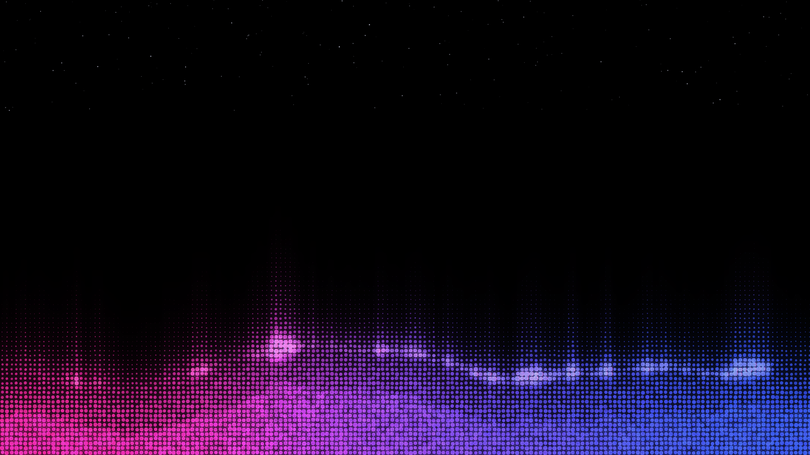

# Halftone Wallpaper

A live macOS desktop wallpaper: an interactive **halftone dot-matrix aurora** —
magenta, violet and royal blue rising out of black — rendered behind your
desktop icons.



The field lives at the desktop window level (below Finder's icons, above the
static picture), so your Mac stays fully usable while the aurora breathes. Drag
your cursor over it and the dots warp, glow, and spring back.

- **~2.7% CPU** animating at 60 fps on Apple Silicon (WebContent ~0.9%, WebKit GPU ~1.8%)
- **0.0–0.1% CPU** with `--still`, and **battery-aware**: unplugging the AC adapter freezes the field automatically; plugging back in resumes it (`--still` pins it frozen regardless of power source)
- **No network, no telemetry, no account.** One ~180-line Swift file + one standalone HTML file.
- **Two flavors:** `HalftoneWallpaper.app` (always-desktop-level) or `HalftoneSaver.saver` (OS-native screen saver — on macOS Sonoma+ System Settings can also show it as wallpaper)

### Windows 11

A Direct3D 11 port lives in [`windows/`](windows/): the same field re-hosted on
one fullscreen-triangle pixel shader (no WebView), embedded in `WorkerW` below
the desktop icons, with the same battery/display-off freeze behavior. Build it
with `windows\build.cmd` (MSVC + Windows SDK). Status: math-verified against
`ripple.html`, **unverified on real Windows hardware** — see
[`windows/README.md`](windows/README.md).

## Install

### Option A — prebuilt app (easiest)

1. Download `HalftoneWallpaper.app.zip` from the latest [Release](../../releases).
2. Unzip and move `HalftoneWallpaper.app` to `~/Applications` (or `/Applications`).
3. Right-click → **Open** once (ad-hoc signed; Gatekeeper needs one approval).
4. To run at every login: **System Settings → General → Login Items → +** → pick the app.

### Option B — build + install yourself

Requires Xcode Command Line Tools (`xcode-select --install`).

```sh
git clone https://github.com/jonathanh1/halftone-wallpaper.git
cd halftone-wallpaper
make install    # builds, installs to ~/Applications + registers a login LaunchAgent
```

`make install` copies the app to `~/Applications/HalftoneWallpaper.app`,
clears its quarantine bit, and installs `~/Library/LaunchAgents/local.halftone-wallpaper.plist`
so it starts automatically at login. `make uninstall` removes both.

### Screen saver (OS-native)

Prefer Apple's own engine? Build the `.saver` bundle — macOS picks it up under **System Settings → Screen Saver → Halftone Aurora** (Sonoma+ also offers "Show as wallpaper"):

```sh
make install-saver
```

The saver reuses the same `ripple.html`; preview thumbnails render the frozen frame so Settings doesn't spin WebContent at 60fps.

### Just try it

```sh
git clone https://github.com/jonathanh1/halftone-wallpaper.git
cd halftone-wallpaper
make run        # builds + opens
```

## Usage

| Action | Command |
|---|---|
| Launch | `open ~/Applications/HalftoneWallpaper.app` |
| Quit | `pkill -x HalftoneWallpaper` or the ◐ menu-bar item → **Quit** |
| Frozen frame (~0 CPU) | `HalftoneWallpaper.app/Contents/MacOS/HalftoneWallpaper --still` |
| Draggable field (covers icons) | `… --interactive` |
| No pointer glow | `… --no-pointer` |
| Battery-aware | unplugging freezes the field; replugging resumes (built-in, no flag) |

The menu-bar **◐** item is the app's only chrome — use it to quit.

- `--still` loads the page with `?motion=off`; the driver renders exactly one frame and drops the rAF loop.
- A `IOPSNotificationCreateRunLoopSource` watches AC/battery transitions and calls `window.__setMotion('off'|'full')` on the live page — the same code path the flags use.

## How it works

```
HalftoneWallpaper.app
└── NSWindow @ .desktopWindow level   (borderless, click-through, all spaces)
    └── WKWebView → Resources/ripple.html   (self-contained Canvas 2D field)
```

- `Sources/main.swift` creates one borderless window per `NSScreen` at
  `CGWindowLevelForKey(.desktopWindow)` — below the icon layer, above the
  desktop picture. `LSUIElement` + `.accessory` keep it out of the Dock and
  Mission Control; `ignoresMouseEvents` makes it click-through.
- `Resources/ripple.html` is the entire renderer: a ~300-line standalone
  Canvas-2D halftone field (dot grid + aurora focal points + pointer spring
  physics + grain + stars). No frameworks, no fetch.
- Since the window never sees the cursor, a 30 Hz `NSEvent.mouseLocation`
  timer injects positions into the page (`window.__feed`) so the field still
  warps under your pointer.
- `--still` loads the page with `?motion=off`; the driver renders exactly one
  frame and drops the rAF loop.

## Customizing

The field lives in `Resources/ripple.html` — tweak colors, dot spacing
(`spacing`), max radius (`rMax`), or the foci set (`FOCI`), then `make`. The
`parts/` directory holds the source pieces the HTML was assembled from
(`_head.html` + `_field_extract.js` + `_driver.js`) for easier editing.

## Cost & compatibility

- Tested on macOS 15 (Apple Silicon, Retina 3456×2234). `LSMinimumSystemVersion` 13.0.
- Ultrawide ready: at aspect ≥ 2.6 (32:9 / 32:10, e.g. a 5120×1440 Odyssey) the
  field switches to a 5-lobe foci set so the aurora stays one continuous band
  instead of three detached hills.
- Ad-hoc signed only — Gatekeeper will ask for right-click → Open once.
- Untested: multi-display layouts (code paths exist), `--interactive` long-term,
  Gatekeeper on managed/MDM machines.

## License

MIT — see [LICENSE](LICENSE).
